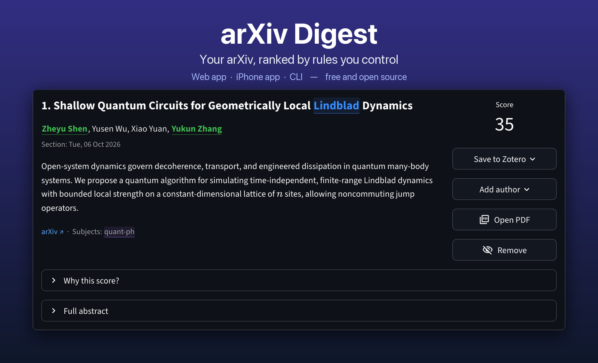
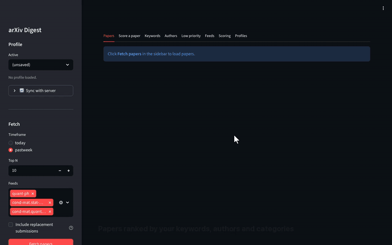

# arXiv digest

[](https://github.com/isaac-tes/arxiv-digest/actions/workflows/ci.yml)
[](https://github.com/isaac-tes/arxiv-digest/releases)
[](LICENSE)
[](https://www.python.org/downloads/)
[](https://isaac-tes.github.io/arxiv-digest/)

<p align="center">
  
</p>

arXiv Digest reads the new papers in the arXiv categories you follow and ranks
them by your own keywords, authors and categories, so the papers you care
about come first.

- **Rules, not a language model.** Every score comes with a breakdown of what
  matched. No API key, no account.
- **Any category.** `quant-ph`, `hep-th`, `cs.LG`, `math.AG`, …
- **Built for reading.** Matches are highlighted, Zotero is one click away, and
  papers you've read can be removed so the next one moves up.
- **Web app, iPhone app and CLI**, with the same features and the same config.

## Quick start

You need [`uv`](https://docs.astral.sh/uv/getting-started/installation/)
(`curl -LsSf https://astral.sh/uv/install.sh | sh` on macOS and Linux).

```bash
git clone https://github.com/isaac-tes/arxiv-digest.git
cd arxiv-digest
uv tool install '.[gui]'
arxiv-gui                     # opens the web app at http://localhost:8501
```

Click **Fetch papers**, then start from a
[starter preset](docs/gui-guide.md#starter-presets) or type your own keywords and
authors. The list re-ranks as you edit. Update later with `arxiv-digest update`.

<p align="center">
  
</p>

## Also available

- **📱 iPhone and iPad app (preview).** Works on its own, fetching and scoring on
  the phone, or shares your settings with the web app through a small
  self-hosted server. Not on the App Store yet:
  [install it with Xcode](docs/ios-app.md).
- **⌨️ CLI.** `arxiv-digest --top 10` prints the same ranking in the terminal,
  or writes Markdown and JSON for cron jobs and notes apps. It reads the same
  `arxiv_config.json` as the web app. See the [CLI guide](docs/cli-guide.md).

## Documentation

| | |
|---|---|
| [Quickstart](docs/quickstart.md) | Install options, updating, running from a clone |
| [GUI guide](docs/gui-guide.md) | Every tab, highlighting, Zotero, profiles and presets |
| [Scoring](docs/scoring.md) | The rules, default weights and how to tune them |
| [CLI guide](docs/cli-guide.md) | All flags, the config file, output formats |
| [iPhone app](docs/ios-app.md) | Install, modes, web ↔ iOS feature table |
| [Sync across devices](docs/deploy.md) | Run the digest server, connect your devices |
| [Troubleshooting](docs/troubleshooting.md) | Common problems and fixes |

Or browse them all on the [documentation site](https://isaac-tes.github.io/arxiv-digest/).

## Similar projects

[AutoLLM/ArxivDigest](https://github.com/AutoLLM/ArxivDigest) asks GPT how
relevant each paper is to a description of your interests and emails you the
result. It needs an OpenAI key and a SendGrid account and hasn't been updated
since May 2024. arXiv Digest is unrelated to it and shares no code: it scores
with rules you can read and change, runs locally on demand, and adds the
browser and iPhone apps and Zotero saving. Both are MIT-licensed.

## Contributing

Bug reports and pull requests are welcome; see [CONTRIBUTING.md](CONTRIBUTING.md).
`uv sync --group dev && uv run pytest` runs the test suite (no network needed).
